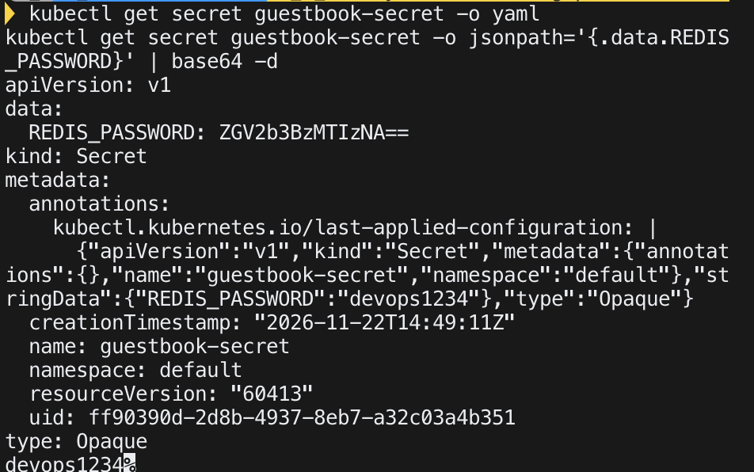
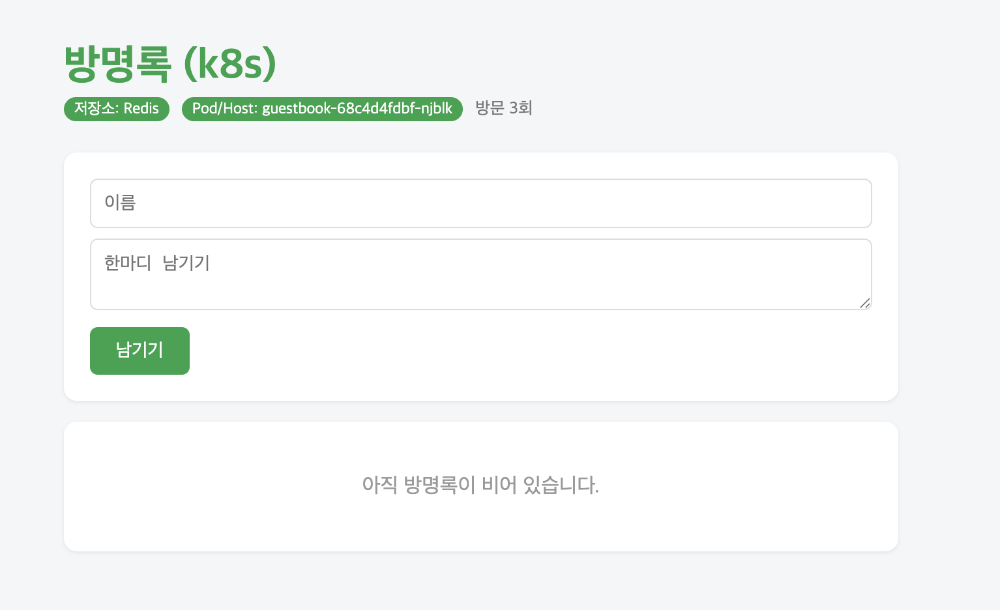
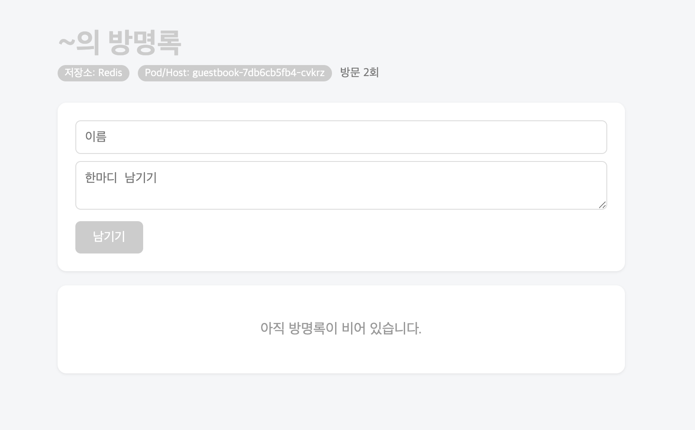
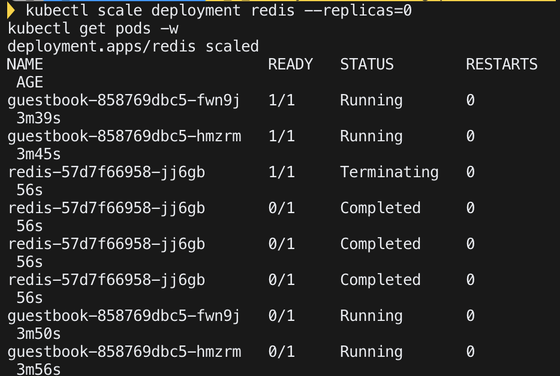
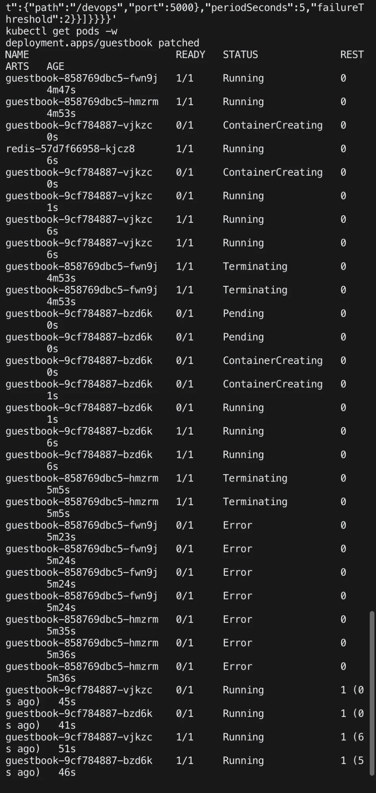

# 11주차 정리 (쿠버네티스 설정과 상태 점검) — ConfigMap / Secret, 헬스체크

## 목표

- 설정을 이미지에서 분리해야 하는 이유를 설명한다.
- Secret이 암호화가 아니라 인코딩임을 알고 그 한계를 설명한다.
- ConfigMap/Secret을 만들어서 Pod에 환경변수로 주입한다.
- liveness/readiness probe를 설정하고, 실패 시 동작을 직접 관찰한다.
- 트러블슈팅 3단 루틴(`get → describe → logs`)을 수행한다.

9주차 끝에 남겼던 고민("비밀번호를 YAML에 그대로 적어서 GitHub에 올리면?", "앱은 살아있는데 응답을 못 하는 상태는 어떻게 알아채지?")을 이번 주에 ConfigMap/Secret과 프로브로 풀었다.

---

## 설정을 이미지에서 분리하는 이유

같은 이미지를 개발/테스트/운영 환경에서 재사용하려면(Build once, run anywhere), 설정값을 이미지 안에 박아두면 안 된다. 환경에 따라 값을 바꾸는 방법은 아래로 갈수록 확정 시기가 실행 시점에 가까워진다.

| 방법 | 확정 시기 |
|---|---|
| 코드 기본값 | 코드 작성할 때 |
| 도커파일 `ENV` | 이미지 빌드할 때 |
| `docker run -e` | 컨테이너 실행할 때 |
| 컴포즈 `environment` | `compose up` 할 때 |
| **ConfigMap / Secret** | **Pod 시작할 때** |

## ConfigMap과 Secret

- **ConfigMap**: 일반 설정값을 담는 이름→값 짝 목록 (파이썬 딕셔너리와 비슷)
- **Secret**: 비밀번호·토큰처럼 민감한 값을 담는 칸. **이름에 속으면 안 된다 — Secret이라고 안전한 게 아니다.**

```yaml
# configmap.yaml
apiVersion: v1
kind: ConfigMap
metadata:
  name: guestbook-config
data:                              # ConfigMap은 spec이 아니라 data
  APP_TITLE: "방명록 (k8s)"
  THEME_COLOR: "#16a34a"
  REDIS_HOST: "redis"
  REDIS_PORT: "6379"
```

```yaml
# secret.yaml  (★ 실제 비밀번호가 들어있어서 Git에는 올리지 않음 — 아래 "비밀번호를 Git에서 분리하기" 참고)
apiVersion: v1
kind: Secret
metadata:
  name: guestbook-secret
type: Opaque
stringData:
  REDIS_PASSWORD: "devops1234"
```

### Secret은 암호화가 아니다

Secret의 `data`는 암호화가 아니라 **base64 인코딩**일 뿐이다. 누구나 디코딩해서 원래 값을 볼 수 있다.

```bash
$ kubectl get secret guestbook-secret -o yaml
apiVersion: v1
data:
  REDIS_PASSWORD: ZGV2b3BzMTIzNA==
kind: Secret
metadata:
  annotations:
    kubectl.kubernetes.io/last-applied-configuration: |
      {"apiVersion":"v1","kind":"Secret","metadata":{"annotations":{},"name":"guestbook-secret","namespace":"default"},"stringData":{"REDIS_PASSWORD":"devops1234"},"type":"Opaque"}
  ...
type: Opaque

$ kubectl get secret guestbook-secret -o jsonpath='{.data.REDIS_PASSWORD}' | base64 -d
devops1234
```



`base64 -d`로 디코딩할 필요도 없이, `last-applied-configuration` 주석 안에 `"REDIS_PASSWORD":"devops1234"`가 **이미 평문으로** 박혀있는 것도 보인다. 이게 Secret이 안전하지 않다는 가장 직접적인 증거다.

| | 하는 일 | 해석 |
|---|---|---|
| 인코딩 (base64) | 표기 방식만 바꿈 | 누구나 가능 |
| 암호화 | 열쇠로 잠금 | 열쇠가 있어야 가능 |
| 해시 | 지문을 만듦 | 역연산 불가능(비교만 가능) |

> [참고] 위 `devops1234`는 실제 서비스 비밀번호가 아니라 강의자료가 제시한 수업용 더미 값이고, 이 Redis는 로컬 minikube 안에서만 떠 있어 외부에서 접근할 수 없다. 그래서 이 화면을 그대로 공개해도 안전하다 — 오히려 "Secret을 믿고 맡기면 안 된다"를 보여주는 게 이 실습의 목적이다. 실제 서비스였다면 접근 권한 관리·저장 시 암호화·외부 비밀 관리 도구를 추가로 써야 한다.

---

## 실습 1 — ConfigMap, Secret, Redis를 만들고 Deployment에 연결

### 1-1. Redis 배포

[redis.yaml](./redis.yaml) — Redis도 Deployment + Service(ClusterIP)로 띄우고, 비밀번호는 Secret에서 바로 받아온다.

```yaml
containers:
  - name: redis
    image: redis:7-alpine
    args: ["redis-server", "--requirepass", "$(REDIS_PASSWORD)"]
    env:
      - name: REDIS_PASSWORD
        valueFrom:
          secretKeyRef: {name: guestbook-secret, key: REDIS_PASSWORD}
```

### 1-2. Deployment에 주입 — envFrom, 자원 제한, 프로브

[deployment.yaml](./deployment.yaml)

```yaml
envFrom:
  - configMapRef: {name: guestbook-config}   # data의 모든 항목을 통째로 환경변수로
  - secretRef: {name: guestbook-secret}
resources:
  requests: {memory: "64Mi", cpu: "100m"}     # 필요하다고 "요청"하는 양 (스케줄러 배치 기준)
  limits: {memory: "128Mi", cpu: "500m"}      # 쓸 수 있는 "한도" — 넘으면 OOMKilled(메모리) / throttling(CPU)
livenessProbe: {httpGet: {path: /healthz, port: 5000}, initialDelaySeconds: 5, periodSeconds: 10, failureThreshold: 3}
readinessProbe: {httpGet: {path: /readyz, port: 5000}, initialDelaySeconds: 3, periodSeconds: 5}
```

```bash
$ kubectl apply -f configmap.yaml -f secret.yaml -f redis.yaml -f deployment.yaml
$ kubectl get pods
NAME                         READY   STATUS    RESTARTS   AGE
guestbook-858769dbc5-fwn9j   1/1     Running   0          3m39s
guestbook-858769dbc5-hmzrm   1/1     Running   0          3m45s
redis-57d7f66958-jj6gb       1/1     Running   0          56s
```

환경변수가 제대로 주입됐는지 직접 확인:

```bash
$ kubectl exec deploy/guestbook -- printenv APP_TITLE THEME_COLOR REDIS_HOST
방명록 (k8s)
#16a34a
redis
```

### 1-3. 설정만 바꾸기 — ConfigMap 수정 → rollout restart

ConfigMap을 고쳐도 **이미 떠 있는 Pod는 모른다** — 환경변수는 프로세스가 시작할 때 한 번만 정해지기 때문이다(터미널에서 `export`를 바꿔도 이미 실행 중인 프로그램은 옛 값을 쓰는 것과 같은 원리). 그래서 `rollout restart`로 Pod를 새로 띄워야 새 값을 읽는다.

**전** — `kubectl apply -f configmap.yaml` 직후, 원래 값(`방명록 (k8s)`, 초록색)



```bash
$ kubectl edit configmap guestbook-config
#  APP_TITLE   → "~의 방명록"
#  THEME_COLOR → "#cccccc"
$ kubectl rollout restart deployment guestbook
$ kubectl rollout status deployment/guestbook
deployment "guestbook" successfully rolled out
```

**후** — 코드를 고치거나 이미지를 다시 빌드하지 않고, ConfigMap 값만 바꿨는데 제목과 색이 바뀌었다.



---

## 상태 점검 — 헬스체크와 프로브

"앱은 살아 있지만 응답을 못 하는 상태"(무한 루프, DB 연결 끊김 등)를 쿠버네티스는 모른다 — 프로세스가 죽지 않았으니 정상이라고 생각한다. 그래서 주기적으로 "괜찮니?"라고 찔러보는 probe가 필요하다.

| | 질문 | 실패 시 |
|---|---|---|
| **livenessProbe** | 살아있니? | 컨테이너를 **죽이고 재시작** |
| **readinessProbe** | 요청 받을 준비 됐니? | **서비스에서 트래픽만 끊음** (재시작 아님) |

### readiness 실패 실험 — Redis를 꺼서 "손님 받을 준비 안 됨" 재현

```bash
$ kubectl scale deployment redis --replicas=0
deployment.apps/redis scaled
$ kubectl get pods -w
NAME                         READY   STATUS        RESTARTS   AGE
guestbook-858769dbc5-fwn9j   1/1     Running       0          3m39s
guestbook-858769dbc5-hmzrm   1/1     Running       0          3m45s
redis-57d7f66958-jj6gb       1/1     Terminating   0          56s
redis-57d7f66958-jj6gb       0/1     Completed     0          56s
guestbook-858769dbc5-fwn9j   0/1     Running       0          3m50s
guestbook-858769dbc5-hmzrm   0/1     Running       0          3m56s
```



Redis가 사라지자 `/readyz`(Redis 연결 확인)가 실패하면서, guestbook Pod 두 개가 **`Running`은 그대로 유지한 채 `READY`만 `1/1` → `0/1`로** 떨어졌다. 죽지 않고 "서비스 명단에서만 빠진" 상태 — 정확히 readiness가 의도한 동작이다.

```bash
$ kubectl scale deployment redis --replicas=1   # 복구
```

### liveness 실패 실험 — 일부러 틀린 경로로 "응급" 상황 재현

```bash
$ kubectl patch deployment guestbook -p \
  '{"spec":{"template":{"spec":{"containers":[{"name":"web",
    "livenessProbe":{"httpGet":{"path":"/devops","port":5000},
    "periodSeconds":5,"failureThreshold":2}}]}}}}'
deployment.apps/guestbook patched
$ kubectl get pods -w
NAME                        READY   STATUS    RESTARTS      AGE
guestbook-9cf784887-vjkzc   0/1     Running   1 (0s ago)    45s
guestbook-9cf784887-bzd6k   0/1     Running   1 (0s ago)    41s
guestbook-9cf784887-vjkzc   1/1     Running   1 (6s ago)    51s
guestbook-9cf784887-bzd6k   1/1     Running   1 (5s ago)    46s
```



존재하지 않는 `/devops` 경로로 바꾸자 liveness probe가 계속 실패했고(`failureThreshold: 2`번 연속 실패 후), kubelet이 컨테이너를 **직접 재시작**시켰다 — `RESTARTS` 숫자가 올라가는 게 증거다. readiness와 달리 컨테이너 자체가 다시 켜진다는 점이 핵심 차이.

```bash
$ kubectl apply -f deployment.yaml   # 원래 probe 설정으로 복구
```

---

## 트러블슈팅 3단 루틴

```bash
1. $ kubectl get pods                    # 상태 확인 (STATUS, READY, RESTARTS)
2. $ kubectl describe pod <이름>          # 맨 아래 Events 확인 — 대부분 정답이 여기 있음
3. $ kubectl logs <이름>                  # 앱 자체의 에러 메시지
   $ kubectl logs <이름> --previous       # 재시작 전 로그 (CrashLoopBackOff일 때)
```

이번 실습에서 실제로 겪은 증상과 원인을 정리하면:

| 증상 | 원인 | 확인 명령 |
|---|---|---|
| `kubectl get secret` 시 `NotFound` | 아직 `apply`를 안 함 | `kubectl get cm,secret`으로 존재 여부 먼저 확인 |
| guestbook이 전부 `0/1`인데 멈춰 있음 | Redis가 `replicas=0`으로 내려간 채 복구를 안 함 | `kubectl get pods`에 `redis-xxx`가 보이는지 확인 |
| ConfigMap 고쳤는데 화면이 그대로 | Pod가 재시작을 안 함 | `kubectl rollout restart deployment guestbook` |
| `RESTARTS`가 계속 올라감 | liveness probe 경로가 잘못됨 | `kubectl describe pod`의 Events에서 `Liveness probe failed` 확인 |

> AI에게 `describe`/`logs` 결과를 붙여넣고 물어봐도 되지만, 무엇을 붙여야 하는지는 이 3단 루틴을 알아야 판단할 수 있고, 답이 맞는지 확인하는 것도 결국 `get pods`로 직접 재확인해야 한다. Secret 값이나 토큰은 지우고 붙여넣을 것.

---

## 비밀번호를 Git에서 분리하기

`week11/secret.yaml`에는 실제 비밀번호(`devops1234`)가 평문으로 들어있어서, 그대로 커밋하면 "DB 비밀번호를 YAML에 써서 GitHub에 푸시"하는 사고를 그대로 재현하게 된다. 그래서:

```bash
$ echo "week11/secret.yaml" >> .gitignore      # 실제 파일은 추적 제외
$ cp week11/secret.yaml week11/secret.yaml.example
$ sed -i '' 's/devops1234/CHANGE_ME/' week11/secret.yaml.example   # 값만 CHANGE_ME로 치환해서 커밋
```

- `secret.yaml` — 로컬에만 존재, 실제 값, Git에는 올라가지 않음
- `secret.yaml.example` — 커밋되는 템플릿. 다른 PC에서 받으면 `cp secret.yaml.example secret.yaml` 후 비밀번호를 채워 넣으면 됨

---

## 고민거리 (다음 시간으로 이어짐)

- 코드 수정 → `docker build` → `docker push` → `kubectl set image`를 매번 손으로 반복하는 건 번거롭고 실수하기 쉽다 → 자동화(CI/CD)가 필요해 보인다.
- 문법 오류가 있는 코드를 실수로 main에 합쳐도 지금은 아무도 막아주지 않는다 → 합치기 전에 자동으로 검사해주는 장치가 필요해 보인다.

## 환경 정리

```bash
$ kubectl delete -f deployment.yaml -f redis.yaml -f secret.yaml -f configmap.yaml
$ minikube stop
```
